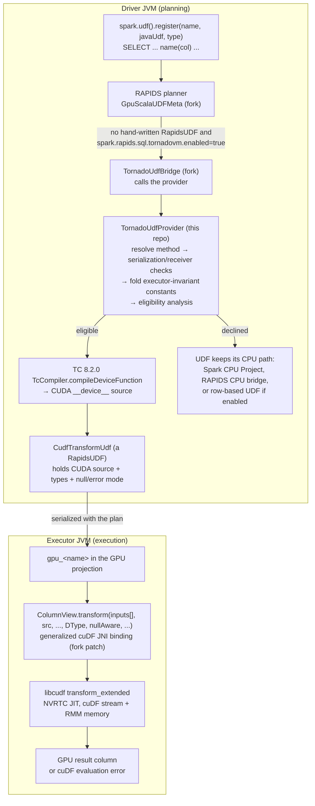

# spark-jitudf

**Transparent GPU execution of eligible numerical Java UDFs in the RAPIDS Accelerator for Apache Spark, compiled by TornadoVM's TC compiler and executed by cuDF.**

A Java UDF registered through ordinary Spark APIs (`spark.udf().register(...)`) is normally opaque
to the RAPIDS Accelerator. When the RAPIDS `udf-compiler` cannot translate it into Catalyst
expressions (a loop is enough), the UDF runs on the CPU: either through the RAPIDS CPU bridge or,
if configured, the row-based UDF operator. Either way each batch leaves the GPU.

This project lets RAPIDS offer such a UDF to a provider during planning. If the UDF is inside a
verified numerical domain, the provider:

1. resolves the method Spark will actually call,
2. checks its bytecode against an explicit eligibility analysis,
3. compiles it **on the driver** with TornadoVM's TC compiler (release 8.2.0, from Maven Central)
   into a CUDA `__device__` function, and
4. returns a `RapidsUDF` that carries the CUDA source to the executors. There, cuDF's own
   `transform` compiles it with NVRTC and runs it over the columns, using cuDF's memory, streams and
   error reporting.

If any step declines, the UDF keeps the CPU path it would have had anyway. The decision is made per
UDF, at planning time, before any data is touched.

The executor path uses no TornadoVM runtime and needs no TornadoVM SDK. The shaded plugin jar does
contain the TC compiler classes, because the same jar is on the driver and executor class paths,
but executors never invoke them.

Arbitrary Java is **not** supported. The supported domain is fixed-width numerical computation and
is documented case by case in [docs/SUPPORTED_UDFS.md](docs/SUPPORTED_UDFS.md).

## Architecture



| | Driver | Executor |
|---|---|---|
| Spark 4.0.4 + patched RAPIDS 26.08.1 distribution | yes | yes |
| `spark-jitudf-plugin` (shaded; includes TC classes) | yes, used | yes, only `CudfTransformUdf` / `CudfListReductionUdf` are used |
| TornadoVM runtime or SDK | no | no |
| CUDA toolkit | no | no (NVRTC is linked into `libcudf.so`) |
| NVIDIA driver and GPU | yes, for RAPIDS | yes |

**Legacy backend.** The repository still contains the earlier *TornadoVM runtime* backend
(`-Dtornado.spark.backend=tornado-runtime`, the default value of that property for historical
reasons). It executes TornadoVM kernels inside executors and needs a TornadoVM 8.2.0 SDK on every
executor. NVIDIA's evaluation advised against running TornadoVM in executors. Everything in this
README and in the support matrix refers to the **TC/cuDF backend**, selected with
`-Dtornado.spark.backend=cudf-transform` on the driver.

## Repositories and versions

| Repository | Role | Branch |
|---|---|---|
| [beestream-ai/spark-jitudf](https://github.com/beestream-ai/spark-jitudf) (this) | The provider (compiler integration), Spark test suites, benchmark and run scripts | `redesign/driver-side-tc-cudf` |
| [beestream-ai/cudf-spark](https://github.com/beestream-ai/cudf-spark) | Fork of NVIDIA's RAPIDS Accelerator: the planner hook, and the generalized cuDF `transform` JNI patch with its build helper | `feature/tornadovm-udf-fallback` |

Exact source revisions, artifact versions, CUDA classifiers and tested GPUs are in
[COMPATIBILITY.md](COMPATIBILITY.md).

## Quick start

Building everything from source takes one long native build (libcudf; about 50 minutes on a
20-thread laptop, measured with a partly warm ccache) and a few short Java builds. The full procedure,
including prerequisites and verification, is in [docs/INSTALL.md](docs/INSTALL.md). In outline:

```bash
git clone -b redesign/driver-side-tc-cudf https://github.com/beestream-ai/spark-jitudf
git clone -b feature/tornadovm-udf-fallback https://github.com/beestream-ai/cudf-spark spark-jitudf/third_party/cudf-spark
cd spark-jitudf
# 1. the generalized cuDF JNI (Docker, CUDA 12.9.1 container, builds for this machine's GPU)
third_party/cudf-spark/upstream-patches/build-cudf-spark-jni.sh "$PWD/third_party/cudf-spark-jni"
# 2. Spark 4.0.4 and the released RAPIDS 26.08.1 jar, then the fork's planner classes patched in
#    (download commands in docs/INSTALL.md)
./scripts/build-rapids-patch.sh
# 3. the generalized JNI folded into that distribution, with linkage checks
./scripts/swap-cudf-jni.sh
# 4. the provider
mvn package
```

Then, with the jars from these steps, an existing tested UDF from this repository runs on the GPU
through ordinary registration (`CollatzUdf` from `CudfTransformIntegrationTest`):

```bash
"$SPARK_HOME/bin/spark-shell" --master 'local[2]' \
  --jars third_party/rapids-4-spark_2.13-26.08.1-tornado-jni.jar,spark-jitudf-plugin/target/spark-jitudf-plugin-0.1.0-SNAPSHOT-with-deps.jar,spark-jitudf-bench/target/spark-jitudf-bench-0.1.0-SNAPSHOT.jar \
  --driver-java-options '-Dtornado.spark.backend=cudf-transform' \
  --conf spark.plugins=com.nvidia.spark.SQLPlugin \
  --conf spark.rapids.sql.tornadovm.enabled=true \
  --conf spark.rapids.cudfVersionOverride=true \
  < docs/examples/quickstart.scala
```

[`docs/examples/quickstart.scala`](docs/examples/quickstart.scala) (fed to `spark-shell` on
standard input) registers the UDF, runs `SELECT sum(collatz(id))` on the GPU and on the CPU,
prints the executed physical plan and the provider's decision, then registers a `String`-returning
UDF to show the fallback. What matters in the plan is `gpu_collatz(id#…)` in the GPU operators
(here inside `GpuHashAggregate`), with no `GpuCpuBridge`. The expected output is in
[docs/INSTALL.md](docs/INSTALL.md#8-run-the-quick-start).

## Documentation

| Document | Contents |
|---|---|
| [docs/INSTALL.md](docs/INSTALL.md) | Prerequisites, step-by-step build of all artifacts, installation into Spark, configuration reference, verification and troubleshooting |
| [docs/SUPPORTED_UDFS.md](docs/SUPPORTED_UDFS.md) | The supported UDF domain: capability matrix with evidence, null and error semantics, floating-point policy, known coverage gaps |
| [docs/VALIDATION.md](docs/VALIDATION.md) | Unit tests, provider coverage corpus, Spark differential, cuDF integration, separate-executor and legacy suites; the representative benchmark and its methodology |
| [COMPATIBILITY.md](COMPATIBILITY.md) | Versions, revisions, classifiers, tested environments |
| [cudf-spark: TORNADOVM_FALLBACK.md](https://github.com/beestream-ai/cudf-spark/blob/feature/tornadovm-udf-fallback/TORNADOVM_FALLBACK.md) | What the RAPIDS fork changes, and the generalized JNI binding |

## Configuration in brief

| Setting | Where | Default | Effect |
|---|---|---|---|
| `spark.rapids.sql.tornadovm.enabled` | Spark conf (fork) | `false` | Offer UDFs RAPIDS cannot run on the GPU to the provider. Off: the fork behaves like the release it was cut from. |
| `-Dtornado.spark.backend=cudf-transform` | driver JVM system property | `tornado-runtime` | Selects the TC/cuDF backend. Without it the legacy runtime backend is used. |
| `spark.rapids.sql.tornadovm.provider` | Spark conf (fork) | `ai.beestream.jitudf.TornadoUdfProvider` | Provider class. |
| `spark.rapids.sql.incompatibleOps.enabled` | Spark conf (RAPIDS) | unset (RAPIDS treats unset as `true`) | Must be set **explicitly** to `true` before the provider compiles any UDF whose reachable code uses floating point; an unset key counts as `false` for the provider. |
| `spark.rapids.sql.rowBasedUDF.enabled` | Spark conf (RAPIDS) | `false` | Use the row-based UDF operator for declined UDFs, which keeps compiled siblings in the same GPU projection (see the support matrix). |

The full reference, including RAPIDS settings and diagnostics, is in
[docs/INSTALL.md](docs/INSTALL.md#configuration-reference).

## Status

A validated engineering prototype for technical review, not a production release. The frozen
source revisions in [COMPATIBILITY.md](COMPATIBILITY.md) passed independent correctness
validation on an RTX 4070 (x86-64, SM 8.9, CUDA 12) and an A100 80GB (aarch64, SM 8.0, CUDA 13).
The evidence covers a curated corpus and test suites, not arbitrary Java. Single-node `local` and
`local-cluster` Spark masters only; no multi-node cluster, multi-GPU or production claim.

## License

Apache License 2.0, see [LICENSE](LICENSE). Copyright (c) 2026 Beestream Ltd. Third-party
components fetched by the build are listed in [NOTICE](NOTICE). The RAPIDS changes live in the
cudf-spark fork under NVIDIA's Apache 2.0 licence and file headers.
